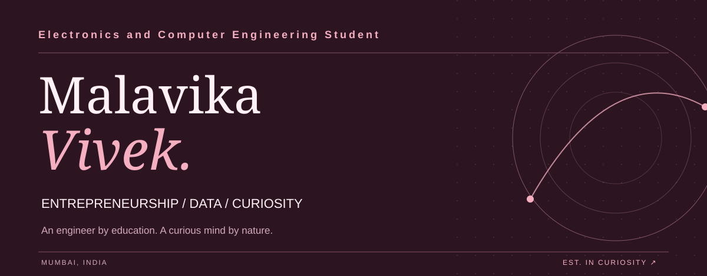
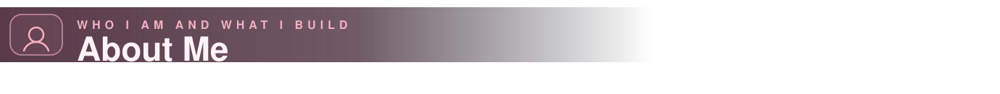
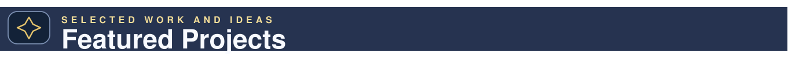
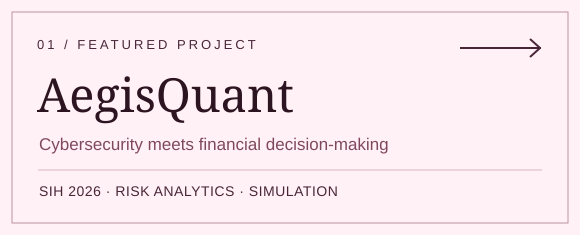
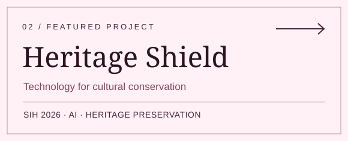
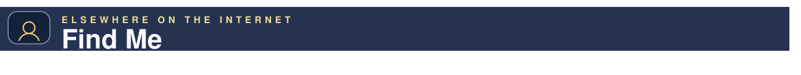
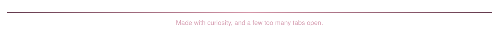

<!-- GitHub profile README: repository name must be techwings0710 -->

  
    
  
  
  

 

 

 

> I am an Electronics & Computer Engineering student at **K J Somaiya College of Engineering**, also pursuing **Management and Data Science at IIT Madras**. I like building at the intersection of **engineering, AI, data, and decision-making** — especially when an idea feels both technically interesting and practically useful.

- **Current focus:** AI/ML · fintech · full-stack software · data-driven problem solving  
- **What I enjoy:** thoughtful interfaces, hackathon builds, product thinking, and learning by making  
- **Right now:** strengthening my foundations while building projects that feel ambitious enough to grow into something bigger

 

<table>
<tr>
<td width="50%" valign="top">
  
    
  A Smart India Hackathon 2026 project focused on translating technical cyber risk into understandable, decision-friendly financial exposure.
    
  <a href="https://github.com/techwings0710/aegisquant"><b>Explore AegisQuant →</b></a>
</td>
<td width="50%" valign="top">
  
    
  A Smart India Hackathon 2026 project exploring AI-assisted monitoring, risk analysis, and resilience planning for cultural heritage conservation.
    
  <i>Repository link can be added when public.</i>
</td>
</tr>
</table>

 

| Chapter | What I worked on |
| :--- | :--- |
| **Software Development Intern** · Verge Impex LLP | Contributed to the development of an “Everything Quantum” website, supporting website building, interface work, and content presentation. |
| **Operations Intern** · Aniverse and Visual Arts Foundation | Supported outreach and coordination work, including engagement connected with delegates from the Annecy International Animation Film Festival. |
| **B.Tech** · K J Somaiya College of Engineering | Electronics & Computer Engineering · Minor in FinTech · GPA: 9.39 |
| **B.S.** · IIT Madras | Management and Data Science |

 

| | |
| :--- | :--- |
| **Code** | Python · C · Java |
| **Working with** | Git · GitHub · Arduino · MATLAB · Excel · VS Code |
| **Learning & exploring** | AI/ML · data analysis · full-stack software · fintech |
| **Also comfortable with** | Canva · MS Word · MS PowerPoint |

 

**[GitHub](https://github.com/techwings0710)** · **[LinkedIn](https://www.linkedin.com/in/malavikavivek07/)** · **[Email](mailto:malavika.vivek@gmail.com)**

 

  

