<!-- Profile repository: techwings0710/techwings0710 -->

  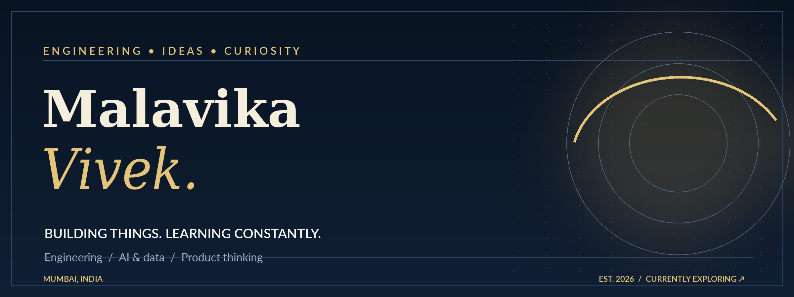
    
  
  
  

 

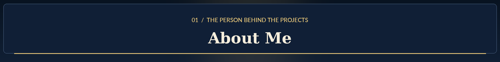
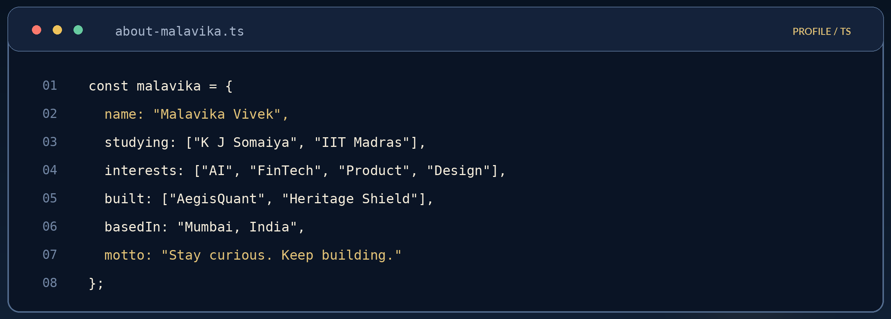

I'm studying **Electronics & Computer Engineering at K J Somaiya** alongside **Management and Data Science at IIT Madras**. I enjoy exploring how software, engineering, data, and creativity can come together to solve real problems.

 

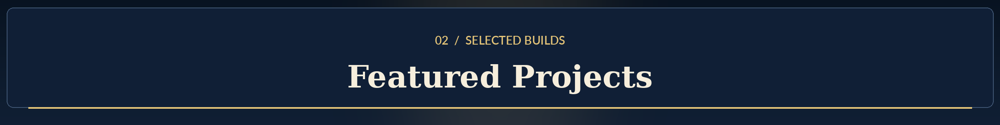

<table><tr>
<td width="50%" valign="top"><a href="https://github.com/techwings0710/aegisquant">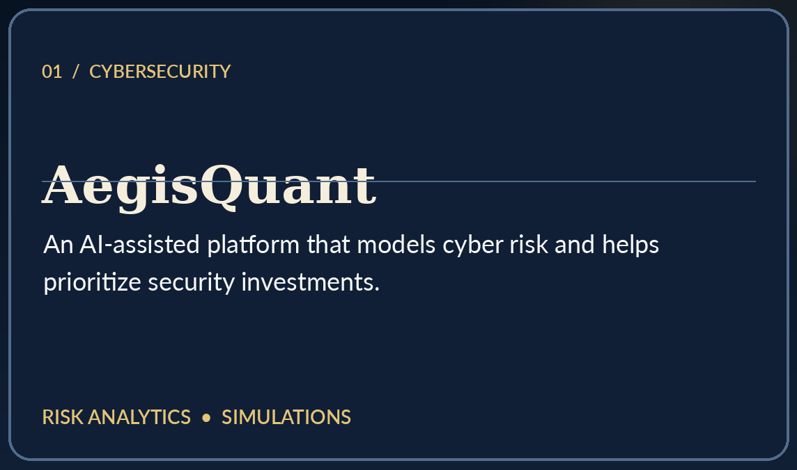</a>
An SIH 2026 team project exploring cyber-risk quantification and security investment prioritization.
<a href="https://github.com/techwings0710/aegisquant">Explore project →</a></td>
<td width="50%" valign="top">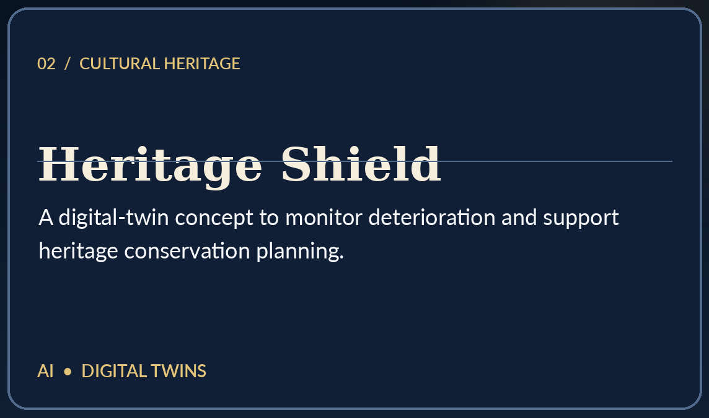
An SIH 2026 team project focused on AI-assisted digital twins and predictive conservation of heritage sites.
<i>Repository link coming when public.</i></td>
</tr></table>

 

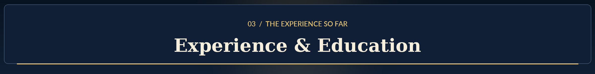
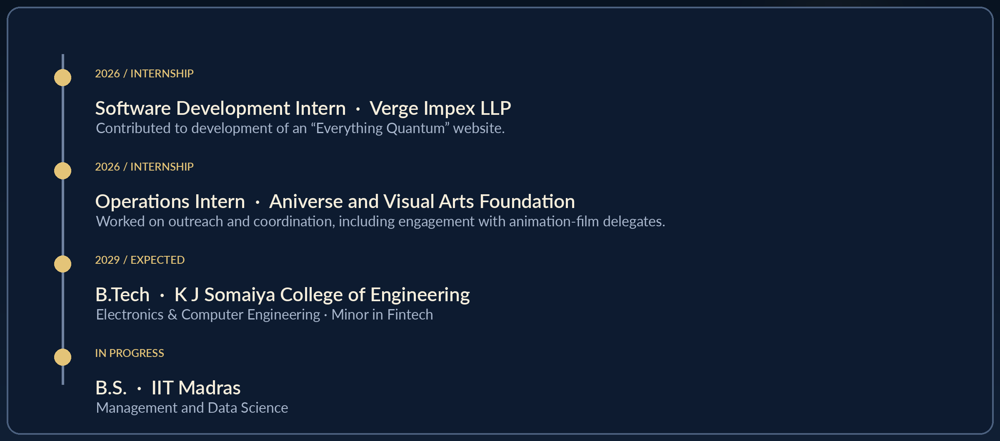

 

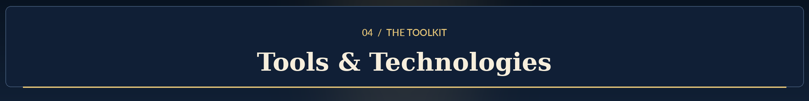
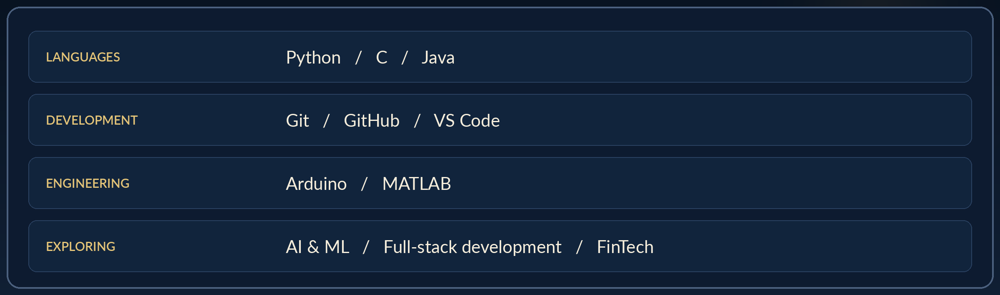

 

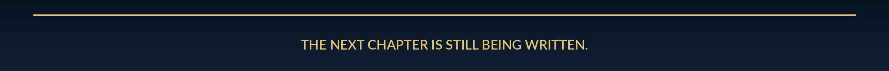

