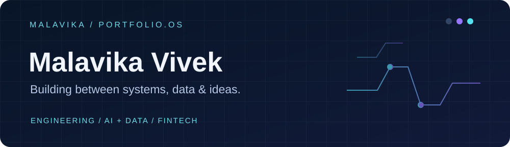

<!-- Place this README.md in a public GitHub repository with the exact same name as your username. -->

  
    
  
  
  

### `> whoami`

I'm an **Electronics & Computer Engineering** student at **K J Somaiya College of Engineering**, also studying **Management and Data Science at IIT Madras**. I like projects that connect technical ideas to problems people actually face — especially **AI, data, fintech, and useful software**.

- 📍 Based in Mumbai, India
- 🧠 Exploring the intersection of **engineering × decision-making × design**
- 🛠️ Most interested in learning by building, testing, and shipping

### `> currently_building`

<table>
<tr>
<td width="50%" valign="top">

**01 / AegisQuant**

*Cyber risk × financial intelligence*

An SIH project exploring how technical security risks can be translated into clearer financial decisions, with risk simulations and analytical visualizations.

[Explore the repository →](https://github.com/techwings0710/aegisquant)

</td>
<td width="50%" valign="top">

**02 / Heritage Shield**

*AI × cultural heritage*

An SIH project focused on technology-assisted conservation, combining risk monitoring and analysis to better understand threats to heritage sites.

<!-- Add the Heritage Shield repository link when it is public. -->

</td>
</tr>
</table>

### `> experience`

**Software Development Intern** · Verge Impex LLP  
Contributed to the development of an “Everything Quantum” website.

**Operations Intern** · Aniverse and Visual Arts Foundation  
Supported outreach initiatives and collaborated with a team engaging with international film-festival delegates.

### `> toolbox`

**Languages:** Python · C · Java  
**Tools:** Git · GitHub · Arduino · MATLAB · Excel  
**Exploring:** AI/ML · data analysis · full-stack development · fintech

### `> activity`

  
  

---

  Making things, breaking things, understanding them, and making them better.

